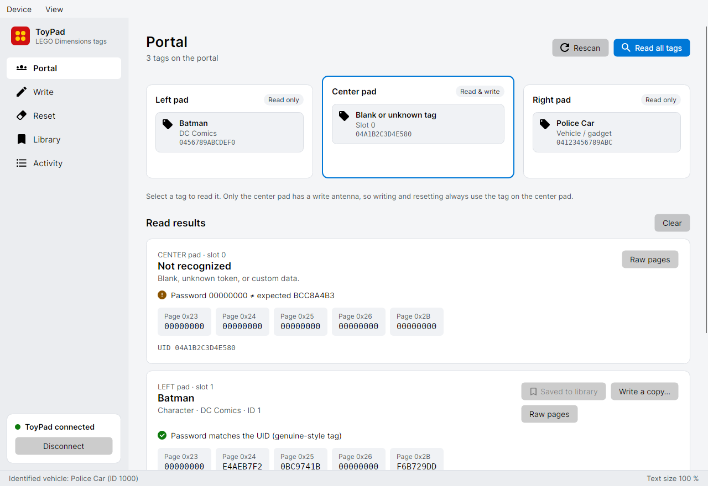
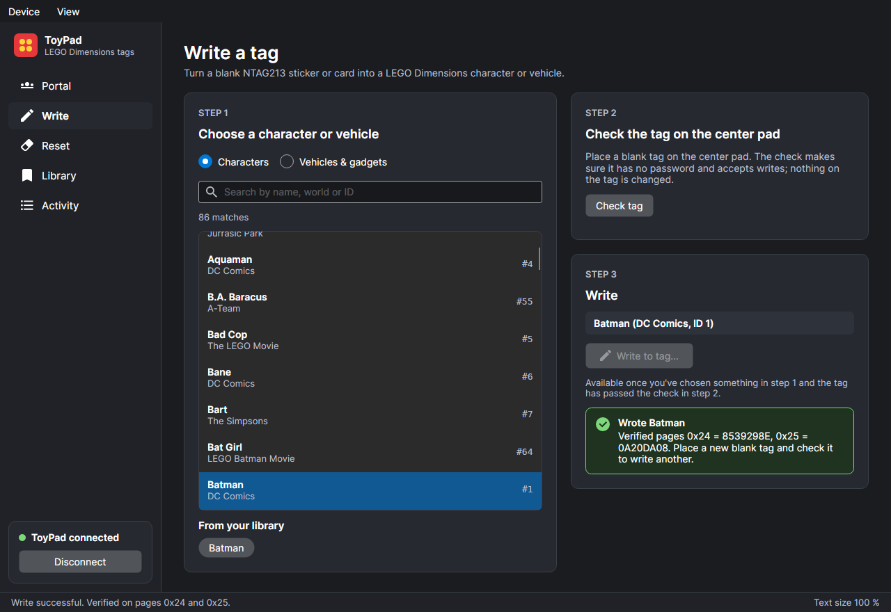

# LEGO ToyPad

A desktop app for reading, writing and resetting LEGO Dimensions ToyPad NFC tags
(NTAG213). It runs on **Windows, Linux and macOS**.

It is built with [Avalonia](https://avaloniaui.net) on .NET 10. It replaces the
Electron version in [xLostPro/LEGO-ToyPad](https://github.com/xLostPro/LEGO-ToyPad),
and the ToyPad protocol and tag crypto are ported from
[sys-MWell/lego-dimensions-toypad-cli](https://github.com/sys-MWell/lego-dimensions-toypad-cli).

| Portal | Write (dark theme) |
| --- | --- |
|  |  |

## Features

- **Portal**: a live view of the left, center and right pads. A tag shows its
  character or vehicle name as soon as it's placed. Select a tag to read it and
  see the decoded identity, the raw pages, and whether its password matches its
  UID.
- **Write**: pick a character or vehicle, check the blank tag on the center pad,
  then write and verify it.
- **Reset**: preview, then erase the character/vehicle pages (and optionally
  the password page) so the tag can be reused.
- **Library**: save anything you've read and write it to more blank tags later.
- **Activity**: the step-by-step device log. Copy it into a bug report if a
  write or reset fails.
- **Demo mode**: `LegoToyPad --demo` runs against a simulated portal, so you can
  try the app without a ToyPad.

Only the center pad has a write antenna. The side pads are read-only on every
ToyPad, so write and reset always use the center tag.

### Accessibility

- Follows the system light/dark theme, or set it under **View › Theme**.
- **View › Larger text** (Ctrl + / Ctrl − / Ctrl 0) scales the whole window up to 200%.
- Everything works from the keyboard. Ctrl+1–5 switch pages, F5 rescans and
  Ctrl+K connects.
- Status is shown with an icon and text, never with color alone. Text colors
  meet WCAG AA contrast in both themes.
- Screen readers get labelled controls, and status and result messages are
  announced as they change.
- Destructive actions ask for confirmation, and **Enter** lands on *Cancel*.

## Install

Download the build for your system from
[Releases](../../releases) (or the artifacts of a manually started CI run). Each one is a single
self-contained file, so you don't need to install .NET.

| OS | Download | Notes |
| --- | --- | --- |
| Windows 10/11 | `LegoToyPad-win-x64.zip` | Unzip and run `LegoToyPad.exe`. |
| Linux | `LegoToyPad-linux-x64.tar.gz` | Install the udev rule once (below), then run `./LegoToyPad`. |
| macOS (Apple Silicon) | `LegoToyPad-osx-arm64.zip` | The app is unsigned. The first time, right-click **LegoToyPad.app › Open**. |
| macOS (Intel) | `LegoToyPad-osx-x64.zip` | Same as above. |

### Linux: USB permissions

By default only root can open the ToyPad. The included rule gives the logged-in
user access:

```sh
sudo cp 99-lego-toypad.rules /etc/udev/rules.d/
sudo udevadm control --reload && sudo udevadm trigger
```

Then unplug the ToyPad and plug it back in.

### Supported hardware

The PS3, PS4 and Wii U ToyPads (USB VID `0E6F`, PID `0241`) are supported. The
Xbox ToyPad uses a different protocol and isn't supported.

## Build from source

You need the [.NET 10 SDK](https://dotnet.microsoft.com/download).

```sh
dotnet run --project src/LegoToyPad.App            # run
dotnet run --project src/LegoToyPad.App -- --demo  # run against the simulator
dotnet test                                        # all tests (no hardware needed)
dotnet publish src/LegoToyPad.App -c Release -r win-x64    # or linux-x64, osx-arm64, osx-x64
```

`dotnet publish -r <rid>` produces one trimmed, self-contained executable of
about 23 MB. To render each UI step as a PNG in light and dark themes, set
`SCREENSHOT_DIR=<folder>` when running the UI tests.

## Project layout

```
src/LegoToyPad.Core       Protocol, crypto, tag workflows, library (no UI)
  Crypto/TagCrypto.cs     UID-keyed TEA cipher + password generator
  Protocol/PacketCodec.cs 32-byte USB frames
  Transport/              HidSharp (real USB) and SimulatedToyPad (tests and --demo)
  ToyPadDevice.cs         Serialized command/response handling and keep-alive
  ToyPadService.cs        Scan, identify, read, write, reset
src/LegoToyPad.App        Avalonia UI (MVVM, CommunityToolkit.Mvvm)
tests/                    Core unit tests + headless UI flow tests
packaging/                udev rule, macOS .app bundling
```

## Changes from the Electron version

- **Native and cross-platform.** USB goes through HidSharp (Windows HID, Linux
  hidraw, macOS IOKit) instead of `node-hid`, so there's no native module to
  compile at install time.
- **Write uses the tag's real UID.** Character data is encrypted with the UID.
  The old app took the UID from the USB "tag detected" event, which isn't always
  reliable. Writes now read the UID back from the tag's memory, the same way
  reads already did.
- **One USB command at a time.** Background scans, auto-identify and user
  actions used to interleave commands on the wire. They are now queued.
- **Unplugging is handled.** Losing the device disconnects cleanly and tells you
  what happened, instead of every later action timing out.
- **Fewer round-trips.** Each USB read returns four pages, so a full raw dump
  takes 12 reads instead of 45.
- **Write is guarded against swapped tags.** If a different tag was placed on
  the center pad after *Check tag*, the write is refused.
- **Tests.** The crypto is checked against values produced by the original
  JavaScript. Read, write, reset, rescan and unplug are tested against a
  simulated ToyPad, and the UI is driven end to end in a headless window.
